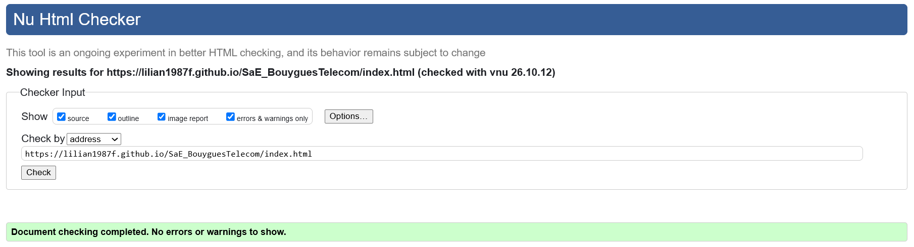
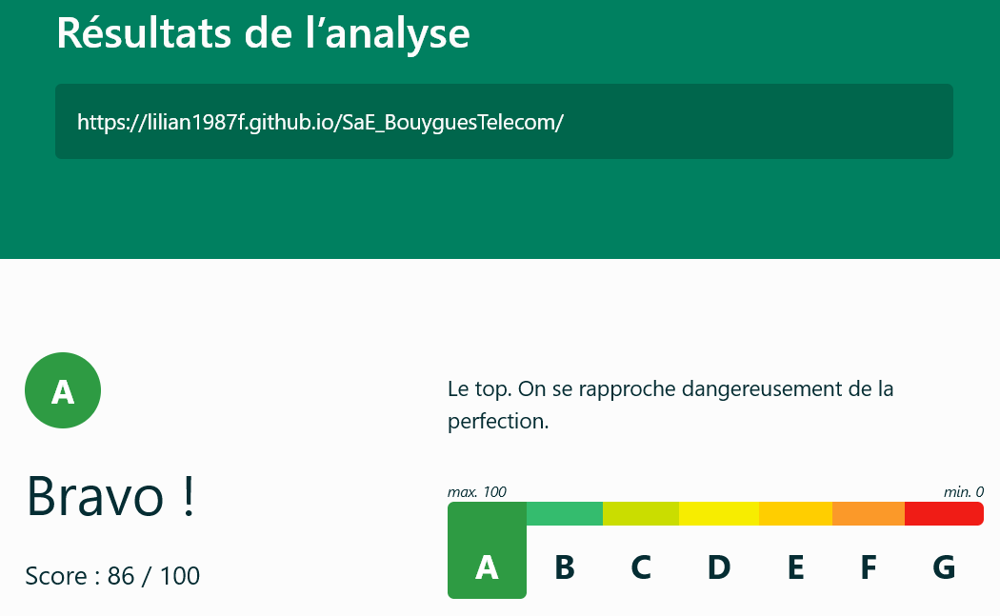
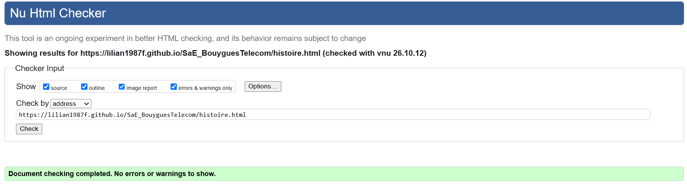
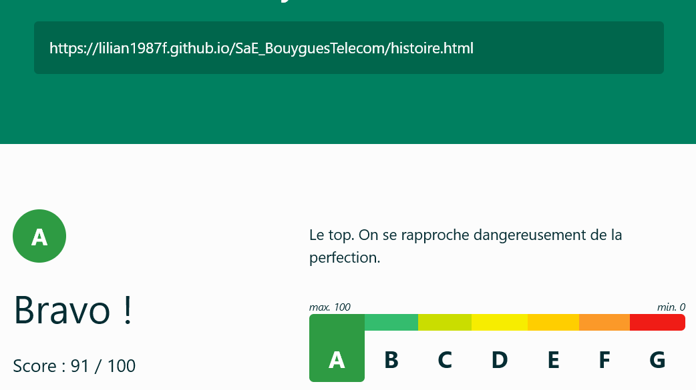
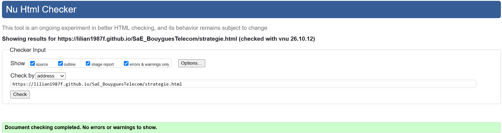
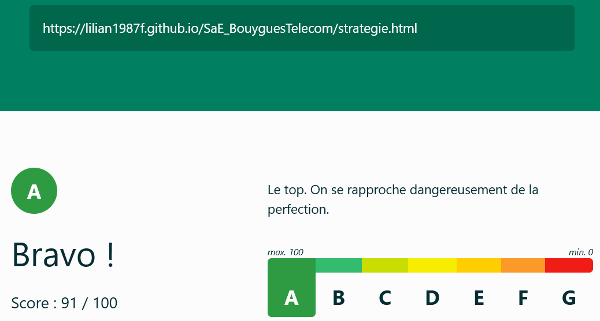
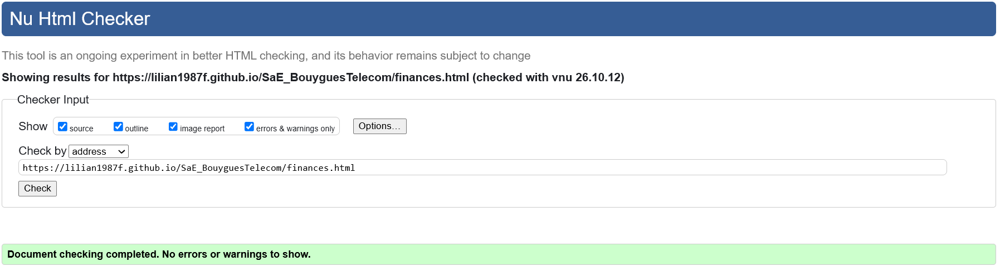
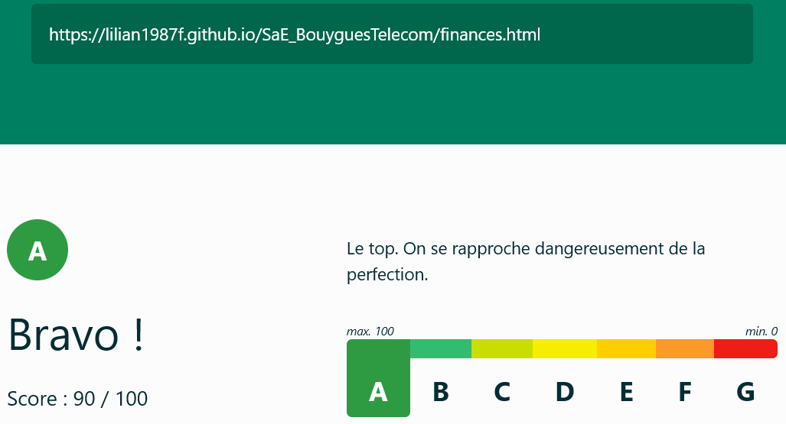
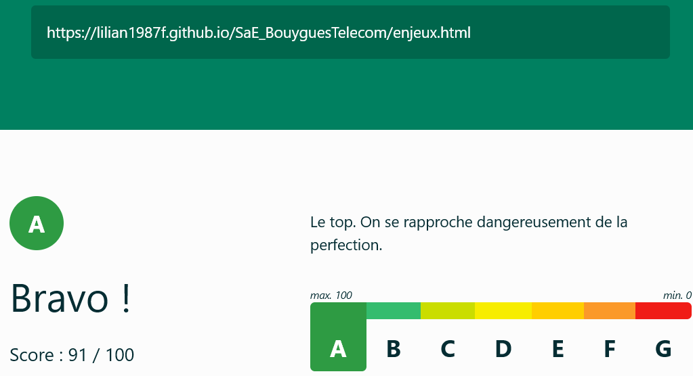

# SaÉ S1. 05-06

## Bouygues Telecom    

[Page principal Bouygues Telecom](https://lilian1987f.github.io/SaE_BouyguesTelecom/)

## Membres du groupe :

Etudiant 1 (référent du groupe) :  [GUIFFARD Lilian](mailto:lilian.guiffard@edu.univ-fcomte.fr?subject=SAE_1_05_06)  
Etudiant 2 : [GAULON Simon](mailto:simon.gaulon@edu.univ-fcomte.fr?subject=SAE_1_05_06)   
Etudiant 3 : [GRATI Mohamed-Mehdi](mailto:mohamed_mehdi.grati@edu.univ-fcomte.fr?subject=SAE_1_05_06)  
Etudiant 4 : [HLAOUI May](mailto:may.hlaoui@edu.univ-fcomte.fr?subject=SAE_1_05_06)  
Etudiant 5 : [HANNACHI Mehdi](mailto:mehdi.hannachi02@edu.univ-fcomte.fr?subject=SAE_1_05_06) 

# Présentation du projet
Dans le cadre de notre SaÉ, nous avons pour projet de créer un site web informatif dédié à Bouygues Telecom. L'objectif est de présenter l'entreprise, son histoire et son positionnement sur le marché des télécommunications. Le site s'appuiera sur des informations économiques telles que son chiffre d'affaires ou sa place face à la concurrence, ainsi que d'autres types d'informations. Ce projet nous permet de mettre en pratique nos compétences web tout en approfondissant notre compréhension du secteur. Nous avons l'intention de réaliser un site digne de la marque, en mobilisant toutes nos connaissances afin de nous améliorer pour les projets futurs.

## Choix de conception  

Pour la conception du site, nous nous sommes grandement inspirés du site officiel de [Bouygues Telecom](https://www.bouyguestelecom.fr/), du site d'un de ses principaux concurrents [Orange](orange.com/fr/groupe) et nous avons pris comme référence le site de [RTE France](rte-france.com/donnees-publications/eco2mix-donnees-temps-reel) pour la page finance disponible.    

## Développement Site Web et Validation des pages

### Page d'accueil

**Auteur : GAULON Simon**  

Vérification W3C : [Détail ICI](https://validator.w3.org/nu/?showsource=yes&showoutline=yes&showimagereport=yes&level=warning&doc=https%3A%2F%2Flilian1987f.github.io%2FSaE_BouyguesTelecom%2Findex.html)

Vérification ecoindex : [Détail ICI](https://www.ecoindex.fr/resultat/?id=e831fb46-5027-4eb0-b8bc-41812406fc7f)

### Page historique

**Auteur : GRATI Mohamed-Mehdi**  

Vérification W3C : [Détail ICI](https://validator.w3.org/nu/?showsource=yes&showoutline=yes&showimagereport=yes&level=warning&doc=https%3A%2F%2Flilian1987f.github.io%2FSaE_BouyguesTelecom%2Fhistoire.html)

Vérification ecoindex : [Détail ICI](https://www.ecoindex.fr/resultat/?id=fc57aae5-0004-4cd7-97c4-4f8d32e360db)

### Page Stratégie

**Auteur : HANNACHI Mehdi**  

Vérification W3C : [Détail ICI](https://validator.w3.org/nu/?showsource=yes&showoutline=yes&showimagereport=yes&level=warning&doc=https%3A%2F%2Flilian1987f.github.io%2FSaE_BouyguesTelecom%2Fstrategie.html)

Vérification ecoindex : [Détail ICI](https://www.ecoindex.fr/resultat/?id=12119003-ce71-42f8-9996-79138b8c33f3)

### Page Finances

**Auteur : HLAOUI May**  

Vérification W3C : [Détail ICI](https://validator.w3.org/nu/?showsource=yes&showoutline=yes&showimagereport=yes&level=warning&doc=https%3A%2F%2Flilian1987f.github.io%2FSaE_BouyguesTelecom%2Ffinances.html)

Vérification ecoindex : [Détail ICI](https://www.ecoindex.fr/resultat/?id=84d6ad2d-1bd5-4649-9395-0f2c55e135db)

### Page Enjeux Futurs

**Auteur : GUIFFARD Lilian**  

Vérification W3C : [Détail ICI](https://validator.w3.org/nu/?showsource=yes&showoutline=yes&showimagereport=yes&level=warning&doc=https%3A%2F%2Flilian1987f.github.io%2FSaE_BouyguesTelecom%2Fenjeux.html)

Vérification ecoindex : [Détail ICI](https://www.ecoindex.fr/resultat/?id=9801a1c4-578c-4185-af5d-1cea5a6b7b9d)

## Répartition du travail

### Planification - Diagramme de GANTT

- Nom Prénom

### Recherches d'informations

- Nom Prénom
- Nom Prénom

### Développement site

- Nom Prénom
  - Page d’accueil
  - "Template" de page (Navbar/Footer)
  - Page présentation
- Nom Prénom
  - Page histoire
- Nom Prénom
  - Page organisation

## Contributeurs

